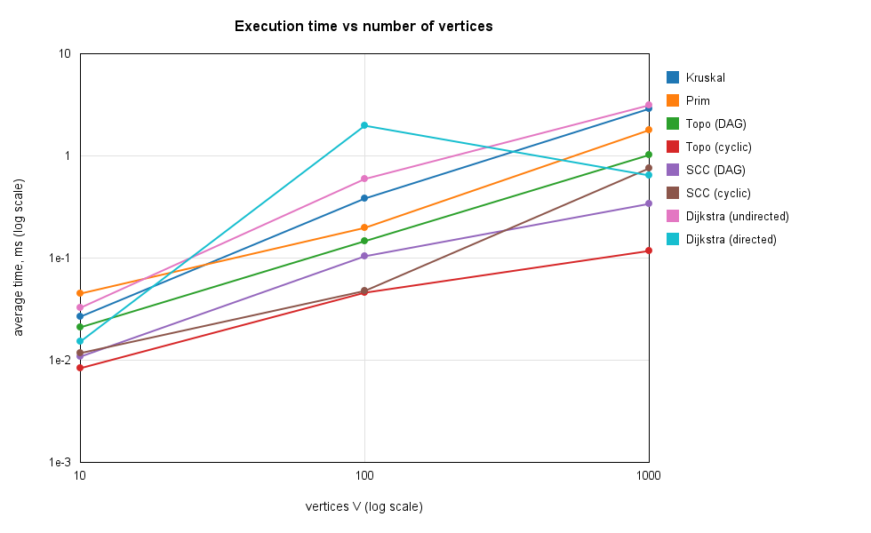
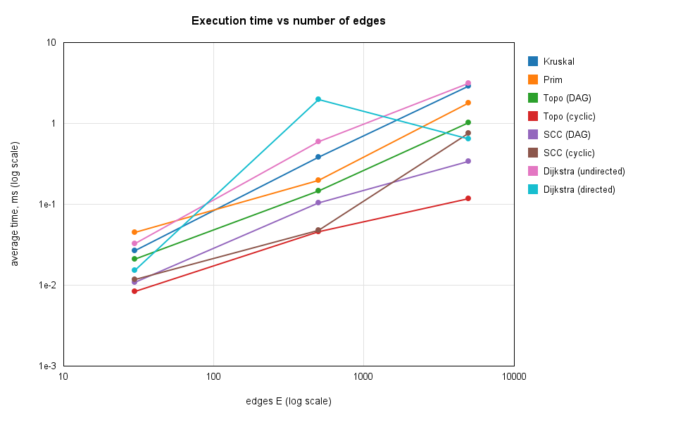
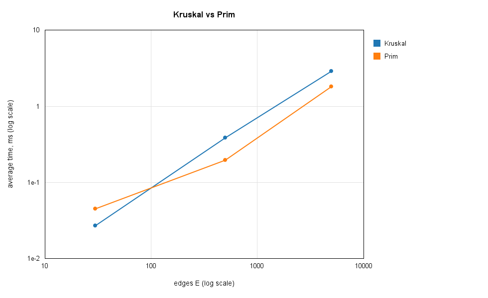
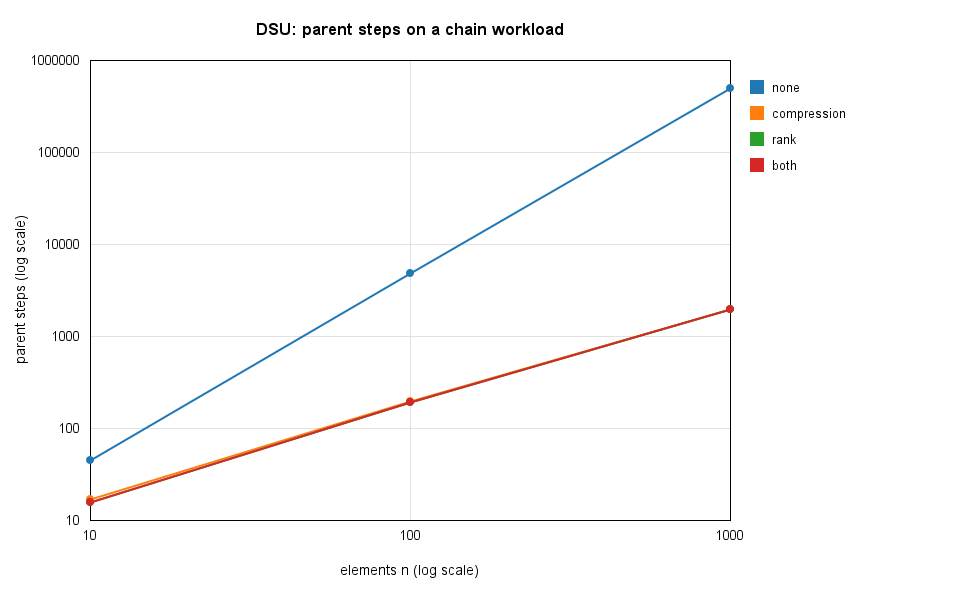

# Assignment 3 - Smart City Infrastructure and Route Planning

Java project that models a city as a graph and runs graph algorithms on it: minimum spanning tree (Kruskal and Prim with a DSU), topological ordering, strongly connected components and Dijkstra shortest paths. The algorithms are benchmarked on three graph sizes and checked with a test suite. This README is the full report.

## Overview

The city is a graph. Vertices are districts, edges are roads or infrastructure links, and weights are construction costs or distances depending on the task.

- **MST (Task 1):** undirected weighted graph, find the cheapest network that connects all districts.
- **Connectivity (Task 2):** directed graph (one-way roads, service dependencies), find a valid build order or report a cycle, and find strongly connected components.
- **Shortest paths (Task 3):** directed or undirected graph with non-negative weights, find the cheapest route from one district to all others.

**Graph representation.** Adjacency list. `Graph` keeps one list of outgoing `Edge` objects per vertex. For an undirected graph every edge is stored in both directions in the adjacency list, but only once in a separate edge list that Kruskal uses. Weights are `int`.

### Project structure

```
assignment-3/
├── src/
│   ├── graph/          Edge, Graph, GraphGenerator
│   ├── dsu/            DSU
│   ├── mst/            Kruskal, Prim, MSTResult
│   ├── connectivity/   TopoSort, TopoResult, Tarjan, SCCResult
│   ├── shortestpath/   Dijkstra, DijkstraResult
│   └── benchmark/      Main (runs experiments, writes CSV), Plots (draws charts)
├── test/               AllTests
├── results/
│   ├── tables/         CSV files written by Main
│   └── plots/          PNG charts written by Plots
└── README.md
```

### How to run

1. Open the project in IntelliJ IDEA. `src` is the sources root and `test` is the test sources root. Set the working directory of the run configurations to the repository root.
2. Run `benchmark.Main`. It runs all experiments and writes four CSV files to `results/tables/`.
3. Run `benchmark.Plots`. It reads the CSV files and writes four PNG charts to `results/plots/`.
4. Run `AllTests` from the `test` folder. It prints PASS or FAIL for every check.

All graphs are generated with a fixed seed, so the operation counts are the same on every run. Only the timings change a little between machines.

## Implementation

**Graph and generator.** `GraphGenerator` builds three kinds of graphs from a seed (`new Random(seed)`), with integer weights from 1 to 100, no self-loops and no duplicate edges.

- *Connected undirected:* first a random spanning tree (each vertex i connects to a random earlier vertex), then random extra edges until the target E is reached. The tree guarantees the graph is connected.
- *Directed acyclic (DAG):* the vertices get a shuffled order and edges only go from earlier to later in that order, so a cycle is impossible.
- *Directed random:* edges between random pairs, no restriction. With these densities the graph contains cycles. This is the graph used for the cyclic tests.

**DSU.** Arrays `parent` and `rank`. `find` is iterative and uses path compression. `union` attaches the lower-rank root under the higher-rank root. Two flags switch compression and rank on and off, so the benchmark can show what each one does. The class also counts `find` calls, successful `union` calls and parent steps (hops).

**Kruskal.** Sorts a copy of the edge list by weight, then goes through the edges and adds an edge when the DSU says its endpoints are in different sets. It stops at V-1 edges. If it ends with fewer than V-1 edges the graph is disconnected and the result is reported as not connected (the edges form a spanning forest).

**Prim.** Lazy version with `PriorityQueue`. It starts from a vertex, pushes all its edges, pops the cheapest edge and skips it if the other end is already in the tree. It restarts from any unvisited vertex, so on a disconnected graph it also gives a spanning forest and the weights stay comparable with Kruskal.

**Topological ordering.** Kahn's algorithm. Compute in-degrees, queue every vertex with in-degree 0, repeatedly remove one and decrease the in-degree of its neighbours. If fewer than V vertices were removed, the graph has a cycle and no ordering exists. A separate `valid` method checks that for every edge u -> v, u comes before v.

**SCC.** Tarjan's algorithm: one DFS with discovery index, low-link value and a stack. When a vertex's low-link equals its own index, everything above it on the stack is one component. The DFS is recursive, which is fine for V up to 1,000.

**Dijkstra.** `PriorityQueue` of (distance, vertex) with lazy deletion: an outdated queue entry is skipped when it is popped. It stores `dist` and `prev`, so the path to any vertex can be rebuilt. Unreachable vertices keep distance `INF` and return an empty path. Negative edges throw an `IllegalArgumentException` before the algorithm starts.

**Why Dijkstra fails with negative weights.** Dijkstra treats a vertex as final the moment it is taken out of the queue, because it assumes any other route can only be longer. A negative edge breaks that assumption. Example: A->B costs 2, A->C costs 5, C->B costs -10. Dijkstra finalizes B with distance 2, but A->C->B costs -5. Bellman-Ford handles this case, and I use it only as a reference in the tests.

## Complexity Analysis

Assumptions: adjacency list, binary heap (`PriorityQueue`), V vertices, E edges. The heap never holds more than E entries, so one heap operation costs O(log E) = O(log V) because E <= V^2.

| Algorithm | Time | Extra space | Notes |
|---|---|---|---|
| DSU `find` / `union` | O(alpha(n)) amortized with both optimizations | O(n) | alpha is the inverse Ackermann function, below 5 for any realistic n. Without optimizations a find can cost O(n). |
| Kruskal | O(E log E) = O(E log V) | O(V + E) | Sorting dominates. The DSU part is O(E alpha(V)). |
| Prim (binary heap) | O(E log V) | O(V + E) | Each edge is pushed at most once per direction. |
| Topological ordering (Kahn) | O(V + E) | O(V) | Every vertex is queued once, every edge is looked at twice. |
| SCC (Tarjan) | O(V + E) | O(V) | One DFS. Recursion depth is up to V. |
| Dijkstra (binary heap) | O((V + E) log V) | O(V + E) | Heap holds up to E entries because of lazy deletion. |

**How V and E affect performance.**

- **DSU:** depends on the number of operations, not on V directly. Rank keeps the trees at height O(log n). Path compression flattens them, so repeated finds are almost constant.
- **Kruskal:** E drives the cost because of the sort. V only matters through the DSU and the stopping point of V-1 edges. Dense graphs (large E) cost more.
- **Prim:** E log V. On dense graphs it avoids the global sort that Kruskal needs, but the heap still grows with E.
- **Topological ordering and Tarjan:** linear in V + E, so doubling the graph should roughly double the time.
- **Dijkstra:** E log V from the heap operations, with the extra V term from the vertex initialization.

## Experimental Setup

**Graph sizes** (fixed seed 42):

| Graph | Vertices (V) | Edges (E) |
|---|---|---|
| Small | 10 | 30 |
| Medium | 100 | 500 |
| Large | 1,000 | 5,000 |

**Graphs used.**

- MST: connected undirected graph (spanning tree plus random edges). The same graph is used for Kruskal and Prim.
- Topological ordering and SCC: a DAG (edges only forward in a random order, so no cycles) and a directed random graph (edges between random pairs, contains cycles).
- Dijkstra: the connected undirected graph and the directed random graph, source vertex 0. On the directed graph some vertices are unreachable.

**Measurement.**

- Each algorithm is run 3 times as warm-up (so the JIT compiler has finished), then 5 measured times. The table shows the average of the 5.
- Time is measured with `System.nanoTime()` inside each algorithm. Graph generation is not included. For Kruskal the sort is included.
- Operation counts do not change between runs, so they are taken from the last run.

**Counted operations.**

| Algorithm | Counters |
|---|---|
| Kruskal | edges examined, sort comparisons, DSU finds, DSU unions |
| Prim | adjacency entries examined, heap comparisons, heap pushes and pops |
| Topological ordering | edge visits (in-degree count plus relaxations), vertices removed |
| Tarjan | edge visits |
| Dijkstra | edges examined, successful relaxations, heap pushes and pops |
| DSU | find calls, successful unions, parent steps |

**DSU experiment.** Four DSU variants (none, path compression only, rank only, both) run two workloads: unions over all edges of the generated graph, and a worst-case chain (`union(i+1, i)` for all i, then `find` on every element).

## Results

All times are the average of 5 runs in milliseconds (after 3 warm-up runs). The raw numbers are in `results/tables/`.

### Kruskal vs Prim

| V | E | Algorithm | Avg time (ms) | MST weight | Edges examined | Comparisons | DSU finds | DSU unions | Heap ops |
|---|---|---|---|---|---|---|---|---|---|
| 10 | 30 | Kruskal | 0.0272 | 129 | 14 | 107 | 28 | 9 | - |
| 10 | 30 | Prim | 0.0452 | 129 | 60 | 203 | - | - | 60 |
| 100 | 500 | Kruskal | 0.3878 | 1170 | 164 | 3827 | 328 | 99 | - |
| 100 | 500 | Prim | 0.1981 | 1170 | 1000 | 7697 | - | - | 1000 |
| 1000 | 5000 | Kruskal | 2.9005 | 13123 | 3356 | 50369 | 6712 | 999 | - |
| 1000 | 5000 | Prim | 1.8217 | 13123 | 10000 | 110958 | - | - | 10000 |

"Edges examined" means different things here. For Kruskal it is the number of edges taken from the sorted list before the tree was complete. For Prim it is the number of adjacency entries looked at. "Comparisons" are the comparisons made by the sort (Kruskal) or by the heap (Prim). "Heap ops" are pushes plus pops.

### Topological ordering and SCC

| Algorithm | Graph | V | E | Avg time (ms) | Edge visits | Result |
|---|---|---|---|---|---|---|
| Topological order | DAG | 10 | 30 | 0.0210 | 60 | valid order |
| Topological order | cyclic | 10 | 30 | 0.0084 | 30 | cycle detected |
| SCC | DAG | 10 | 30 | 0.0110 | 30 | 10 components |
| SCC | cyclic | 10 | 30 | 0.0118 | 30 | 1 component |
| Topological order | DAG | 100 | 500 | 0.1491 | 1000 | valid order |
| Topological order | cyclic | 100 | 500 | 0.0466 | 500 | cycle detected |
| SCC | DAG | 100 | 500 | 0.1047 | 500 | 100 components |
| SCC | cyclic | 100 | 500 | 0.0477 | 500 | 1 component |
| Topological order | DAG | 1000 | 5000 | 1.0228 | 10000 | valid order |
| Topological order | cyclic | 1000 | 5000 | 0.1193 | 5054 | cycle detected |
| SCC | DAG | 1000 | 5000 | 0.3425 | 5000 | 1000 components |
| SCC | cyclic | 1000 | 5000 | 0.7571 | 5000 | 18 components |

The DAGs are generated with edges only going forward in a random vertex order. The cyclic graphs are random directed graphs with no restriction on edge direction.

### Dijkstra (source vertex 0)

| Graph | V | E | Avg time (ms) | Edges examined | Relaxations | Heap ops | Reachable |
|---|---|---|---|---|---|---|---|
| undirected | 10 | 30 | 0.0326 | 60 | 17 | 36 | 10 |
| directed | 10 | 30 | 0.0154 | 30 | 11 | 24 | 10 |
| undirected | 100 | 500 | 0.6036 | 1000 | 199 | 400 | 100 |
| directed | 100 | 500 | 1.9815 | 500 | 149 | 300 | 100 |
| undirected | 1000 | 5000 | 3.1460 | 10000 | 1986 | 3974 | 1000 |
| directed | 1000 | 5000 | 0.6494 | 4946 | 1419 | 2840 | 990 |

### DSU

Parent steps (hops) taken by `find`. "edges" means union over all edges of the generated graph. "chain" means `union(i+1, i)` for every i followed by a `find` on every element, which is the worst case for a DSU without optimizations.

| Workload | n | none | compression only | rank only | both |
|---|---|---|---|---|---|
| edges | 10 | 181 | 57 | 46 | 46 |
| edges | 100 | 40,988 | 1,300 | 888 | 888 |
| edges | 1000 | 4,234,431 | 15,405 | 8,985 | 8,985 |
| chain | 10 | 45 | 17 | 16 | 16 |
| chain | 100 | 4,950 | 197 | 196 | 196 |
| chain | 1000 | 499,500 | 1,997 | 1,996 | 1,996 |

Average time in milliseconds:

| Workload | n | none | compression only | rank only | both |
|---|---|---|---|---|---|
| edges | 10 | 0.0106 | 0.0039 | 0.0033 | 0.0033 |
| edges | 100 | 0.1899 | 0.0467 | 0.0488 | 0.0104 |
| edges | 1000 | 6.3631 | 0.1422 | 0.1222 | 0.1519 |
| chain | 10 | 0.0014 | 0.0010 | 0.0020 | 0.0043 |
| chain | 100 | 0.0311 | 0.0077 | 0.0076 | 0.0026 |
| chain | 1000 | 1.1538 | 0.0174 | 0.0171 | 0.0182 |

The number of `find` and `union` calls is the same for all four variants: 2E finds and V-1 unions on the "edges" workload, and 3V-2 finds and V-1 unions on the chain.

### Plots

Both axes use a log scale, because the sizes and the times each cover several orders of magnitude.









## Comparison and Discussion

**Kruskal vs Prim.** Both returned the same MST weight on every graph (129, 1170 and 13123), as they should. Prim was faster on the medium graph (0.1981 ms against 0.3878 ms, about 2 times) and on the large graph (1.8217 ms against 2.9005 ms, about 1.6 times). On the small graph Kruskal was faster, but both times are below 0.05 ms, where timer resolution and JIT effects matter, so I do not read much into it.

The operation counts show different things. Kruskal looked at fewer edges (14 of 30, 164 of 500, 3356 of 5000) because it stops after V-1 unions, while Prim looks at every adjacency entry, which is 2E. Kruskal's sort made between 73% and 85% of E log2 E comparisons (107, 3827, 50369), which fits the O(E log E) analysis. Prim's heap made about twice as many comparisons as Kruskal's sort (203, 7697, 110958), but it was still faster. So the comparison count did not predict the time. My guess is that Kruskal pays for copying and sorting all E edges even though it only needs part of them, plus the DSU calls (6712 finds on the large graph), while Prim has no sort and no DSU. I did not profile this, so it is only a guess. Both algorithms are O(E log V) in theory, and the measurements agree with that up to a constant factor. My graphs are sparse (E is between 3V and 5V), so these results say nothing about dense graphs.

**DSU.** Without any optimization the chain workload needed 499,500 parent steps for n = 1000, which is exactly n(n-1)/2. That is the O(n) per `find` worst case from the complexity analysis, and it grows quadratically. With union by rank the same workload needed 1,996 steps, about 250 times fewer. On the edges workload the difference is even bigger: 4,234,431 steps without optimizations against 8,985 with rank (about 470 times fewer). In time, the version without optimizations was roughly 40 to 60 times slower for n = 1000 (6.3631 ms against 0.1519 ms on edges, 1.1538 ms against 0.0182 ms on the chain).

Path compression alone gave almost the same step count as rank alone on the chain (1,997 against 1,996), and using both did not reduce the steps below rank alone. In my workloads the trees built by rank were already so shallow that compression had little left to flatten. I would expect compression to matter more when finds are repeated on deep nodes, but I did not test that. At n = 10 the times are around 0.001 to 0.004 ms and the differences between variants are noise.

**Topological ordering.** On DAGs the number of edge visits was exactly 2E (60, 1000, 10000): one pass to count in-degrees and one when each vertex is removed. That matches O(V + E). On the cyclic graphs the algorithm correctly reported that no order exists on all three sizes. Its edge visits were only 30, 500 and 5054, and its time was lower than on DAGs (0.0084, 0.0466, 0.1193 ms). This is not because cycle detection is cheaper in general. The random directed graphs have almost no vertex with in-degree 0, so the algorithm has nothing to start from and stops early. At V = 10 and V = 100 it removed no vertex at all (edge visits equal E), and at V = 1000 only a few.

**SCC.** Tarjan's algorithm made exactly E edge visits in every run (30, 500, 5000), which is the single DFS from the analysis. On the DAGs every vertex was its own component, and on the random directed graphs there was 1 component at V = 10 and V = 100 and 18 components at V = 1000. For the runtime as the graph grows: on DAGs it went from 0.0110 to 0.1047 to 0.3425 ms, and on the cyclic graphs from 0.0118 to 0.0477 to 0.7571 ms. When V + E grew by a factor of 10 (from the medium to the large graph) the DAG time grew about 3 times and the cyclic time about 16 times. So the growth is not a clean straight line. I think the small sizes are affected by overhead and JIT warm-up, and the cyclic graph has a very large component and deep recursion, but I did not test either explanation.

**Dijkstra.** The edge examinations match the theory: on the undirected graphs they were 2E (60, 1000, 10000), and the heap operations are 2 times the number of pushes (relaxations plus the start vertex), for example 2 x (1986 + 1) = 3974. On the undirected graphs time grew with the size (0.0326, 0.6036, 3.1460 ms). On the directed graph with 1000 vertices, 10 vertices were unreachable. They kept infinite distance, and their outgoing edges were never examined, which is why edge examinations were 4946 and not 5000. One result looks wrong: the directed graph with V = 100 took 1.9815 ms, which is slower than the undirected one with the same size (0.6036 ms) and slower than the directed graph with V = 1000 (0.6494 ms), although it did the least work (500 edge examinations and 300 heap operations). I think this is a measurement outlier, for example from garbage collection or the JIT compiler, and not a real effect. For Dijkstra I trust the operation counts more than the times.

**Theory and experiment.** Operation counts matched the analysis closely: 2E for topological ordering, E for SCC, 2E edge examinations for Dijkstra and Prim on undirected graphs, E log E comparisons for Kruskal's sort. The times matched less well, because they are small (most below 3 ms), measured on only three sizes, and affected by the JIT compiler and garbage collection. The plots show the trend but with only three points per line I would not trust the slopes.

**Limitations.** Only three graph sizes, one seed, and only sparse graphs (E between 3V and 5V). A larger experiment with more sizes and with dense graphs would show the differences between the algorithms better.

## Testing

All tests are in `test/AllTests.java`. It is a plain Java class (no framework) that prints PASS or FAIL for each check and a total at the end. Result: <<TOTAL PASSED / FAILED>>.

**Required cases.**

| Case | Where it is tested |
|---|---|
| Small graphs | hand-checked MST (weight 6), DAG, SCC and Dijkstra graphs |
| Disconnected graph | Kruskal and Prim both report not connected, forest weight 3 |
| Graphs with cycles | topological sort reports a cycle and returns no ordering; SCC finds the cycle components |
| Multiple valid MSTs | 4-cycle with all weights 1: both algorithms return weight 3 (the chosen edges may differ) |
| Unreachable vertices | Dijkstra keeps `INF` and returns an empty path for an isolated vertex |
| Duplicate edge weights | triangle with all weights 5: both algorithms return weight 10 |
| Single vertex | MST weight 0, topological order [0], one SCC, Dijkstra distance 0 |

**Correctness checks.**

- Kruskal and Prim give the same weight on every connected graph. Besides the hand-made graphs, this is tested on 150 random connected graphs (3 sizes, 50 seeds each).
- Topological ordering is valid on every DAG: a checker confirms that for every edge u -> v, u appears before v. Tested on hand-made and 150 random DAGs.
- Cyclic graphs are identified: the sort reports "not a DAG". Tested with a small cycle and with random graphs that contain a Hamiltonian ring.
- Every vertex belongs to exactly one SCC: checked on hand-made, DAG, full-cycle and random directed graphs.
- Dijkstra gives correct distances: compared with hand-computed distances and with Bellman-Ford on 300 random graphs. Negative weights are rejected.
- DSU: union returns false for vertices already joined, `connected` and the set count are correct after a series of unions.

## Conclusion

All the required algorithms work on the three graph sizes, and the test suite passes (<<TOTAL PASSED / FAILED>>). Kruskal and Prim always returned the same MST weight, topological ordering was valid on every DAG and detected every cycle, every vertex ended up in exactly one SCC, and Dijkstra matched Bellman-Ford on all random test graphs.

In the experiments, Prim was faster than Kruskal on the medium and large graphs (about 2 and 1.6 times), even though both are O(E log V). The operation counts matched the theory: 2E edge visits for topological ordering, E for SCC, and about E log E comparisons for Kruskal's sort. In the DSU test, the difference between no optimization and union by rank was large: for n = 1000 the chain workload needed 499,500 parent steps without optimizations and 1,996 with rank. Path compression did not add much on top of rank in my workloads. The smallest graphs gave times that were too short to compare reliably, and one Dijkstra time (directed, V = 100) is an outlier, so I based my conclusions on the operation counts where I could.

Which algorithm fits which task:

- **Connecting all districts at minimum cost:** Kruskal or Prim. Both gave the same cost. Prim was faster on my sparse graphs, but I did not test dense graphs, so I cannot say which is better there. Kruskal is simple when the roads are already a list of edges.
- **Build order for services that depend on each other:** topological ordering. If it reports a cycle, no valid order exists.
- **Groups of districts that can all reach each other, or circular dependencies:** SCC with Tarjan's algorithm. One pass is enough.
- **Cheapest route from one district to all others:** Dijkstra, as long as all weights are non-negative. With negative weights it gives wrong results, and Bellman-Ford would be needed.
